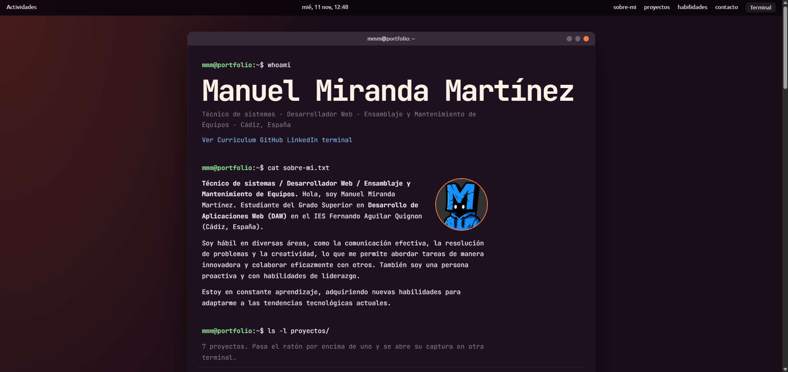

# Portfolio de Manuel Miranda Martínez

Portfolio personal que presenta mi perfil, proyectos, habilidades y datos de contacto mediante una interfaz inspirada en un escritorio Ubuntu y una terminal interactiva. Está construido con HTML, CSS y JavaScript, sin frameworks ni pasos de compilación.



- Sitio web: [mmirandamartinez.com](https://mmirandamartinez.com/)
- GitHub: [@mmirandamartinez](https://github.com/mmirandamartinez)

## Funcionalidades

- Interfaz adaptable a escritorio, tablet y móvil.
- Terminal interactiva con comandos como `ls`, `cd`, `pwd`, `cat`, `mkdir`, `touch`, `rm`, `cp`, `mv`, `echo`, `tree` y `help`.
- Sistema de archivos virtual en memoria para explorar y editar archivos de demostración.
- Editor integrado inspirado en GNU nano, con edición y guardado en memoria.
- Ventanas arrastrables y vistas previas de las capturas disponibles en los proyectos.
- Animación de escritura que respeta la preferencia del sistema para reducir el movimiento.

## Tecnologías

- HTML5
- CSS3
- JavaScript sin frameworks
- Google Fonts para las tipografías

Las fuentes se cargan desde Google Fonts, por lo que se necesita conexión a Internet para mostrarlas. El resto del proyecto no requiere dependencias ni compilación.

## Estructura

```text
.
├── assets/           # Favicon, fotografía, icono y capturas de proyectos disponibles
├── scripts/
│   └── app.js         # Terminal interactiva, sistema de archivos y ventanas
├── styles/
│   └── style.css      # Estilos y adaptación a distintos tamaños de pantalla
├── index.html         # Contenido y estructura de la página
├── LICENSE            # Licencia de uso con atribución obligatoria
└── README.md          # Documentación del proyecto
```

## Ejecución local

No hace falta instalar dependencias. Desde la carpeta del proyecto, inicia un servidor local:

```bash
python -m http.server 8000
```

En Windows también puedes usar `py -m http.server 8000`. Después, abre [http://localhost:8000](http://localhost:8000) en el navegador. Para detener el servidor, pulsa `Ctrl+C` en la terminal.

## Créditos y licencia

El código fuente se distribuye bajo la [Licencia de uso con atribución obligatoria](LICENSE). Puedes utilizarlo, modificarlo y redistribuirlo, incluso en proyectos comerciales, siempre que conserves la licencia y añadas un crédito visible a:

**Código original: Manuel Miranda Martínez** — [GitHub](https://github.com/mmirandamartinez) · [Sitio web](https://mmirandamartinez.com/)

El crédito debe aparecer en los créditos, la documentación o una sección equivalente del proyecto que reutilice el código. La licencia cubre el código fuente de este repositorio; no concede derechos sobre fotografías, capturas, marcas ni otros recursos de terceros.

Esta es una licencia personalizada para exigir atribución visible; no es una licencia estándar como MIT o BSD.